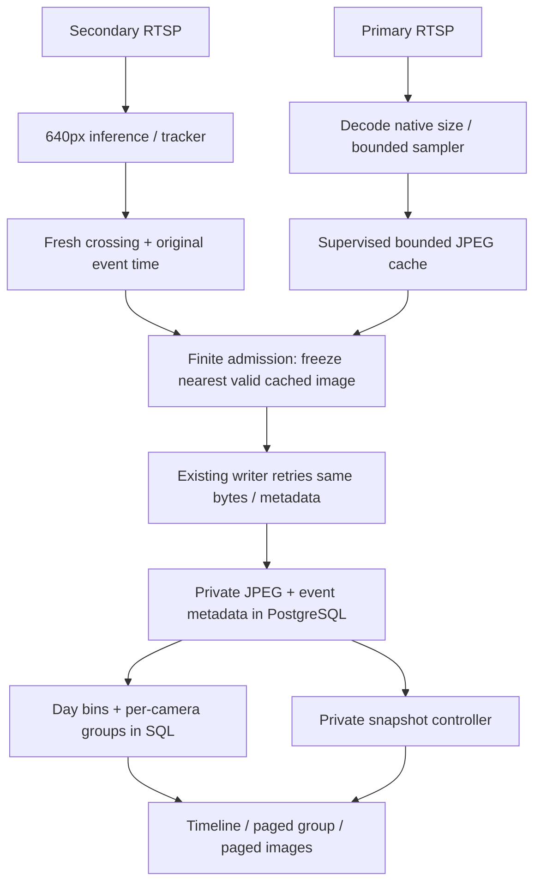

# System map

## Places and affordances

| Place | Affordance | Effect / backing state |
|---|---|---|
| /visitors | UTC day + camera + direction selectors | Validated URL params; one selected day for timeline, preserve legacy range view |
| /visitors | Daily activity strip (288 bins) | Highlight image activity; label exact times/counts, select an interval |
| /visitors | Paged activity groups | Per-camera first/last image time + count; select group without losing day/filters |
| /visitors | Streamed image page | Existing private image URLs; badges Principal / Secondary fallback / Historical |
| /visitors/events/:id | Image detail and Back to group | Original high-resolution image, crossing and image receipt times, quality/dimensions; preserved query params |
| Empty/loading/failure | Explicit feedback | Empty day differs from query failure; stale group selection resets safely |

## Data and signal paths

Admission never waits for RTSP, JPEG encoding or a new frame. Missing/stale primary invokes the explicitly selected fallback policy. Only persisted images appear in the timeline; grouping changes navigation, not event/file retention or tracking.

## Navigation state

URL state: view mode, day or legacy date range, camera, direction, selected bin/group anchor, group page, image page, optional event ID. Server validates every value and resolves group membership; no client-provided SQL or file paths. Patch within the existing LiveView, preserving filters when opening/closing details. On live updates coalesce refreshes; selected windows remain fixed until user changes them. If a group merges/expires, show a brief notice and reconcile selection instead of silently showing unrelated images.
